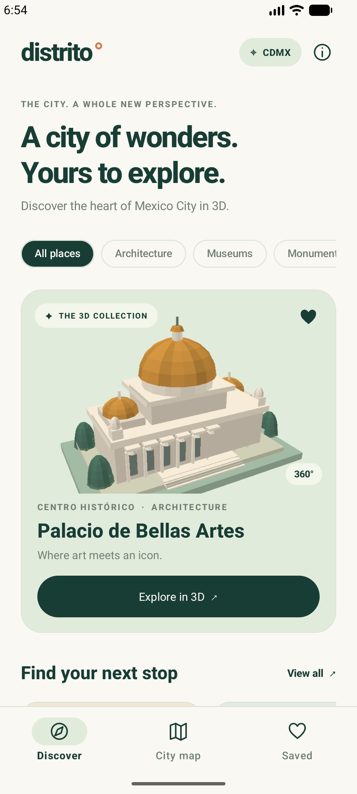
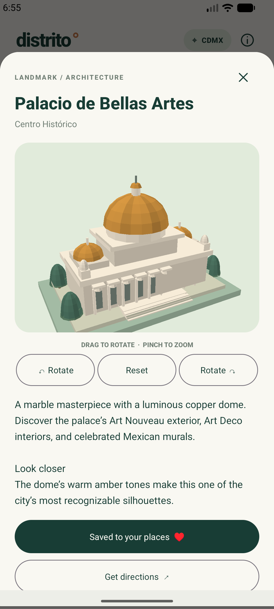
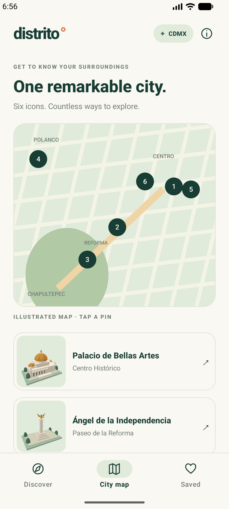

# Distrito

A native Kotlin and Android Views app using Material 3, with interactive, stylized 3D Mexico City landmarks and an offline attraction collection.

Explore the Palacio de Bellas Artes, Ángel de la Independencia, Castillo de Chapultepec, Museo Soumaya, Catedral Metropolitana, and Monumento a la Revolución.

## Screenshots

Captured from the app running in the Android emulator.

| Discover | Interactive 3D viewer | City map |
| :---: | :---: | :---: |
|  |  |  |

## Features

- Six handcrafted, procedural landmark models with drag-to-rotate, pinch-to-zoom, rotation buttons and camera reset.
- Discovery categories for architecture, museums and monuments.
- Saved places persisted on the device.
- An illustrated city map with tappable landmark pins and directions through an installed maps app.
- Offline models and stories, with a warm ivory and deep teal Material 3 interface.

The models are artistic interpretations. The illustrated map is a guide to the collection; route navigation is handled by the external maps app.

## Getting started

Open the project root in Android Studio, let Gradle sync, select the `app` run configuration, and choose an emulator or Android device.

The checked-in configuration uses:

| Setting | Value |
| --- | --- |
| Minimum Android version | Android 10 / API 29 |
| Compile / target SDK | 37 |
| Android Gradle Plugin | 9.5.0, with built-in Kotlin support |
| Gradle wrapper | 9.6.0 |
| Gradle daemon toolchain | JDK 25 |
| Application ID | `xyz.eliothmonroy.a3dtest` |

Use an Android Studio installation that supports the configured AGP version and install Android SDK 37. The daemon toolchain configuration supports downloading its JDK; the first sync/build needs network access. Keep your local SDK location in the ignored `local.properties` file.

### Build

```sh
./gradlew :app:assembleDebug
```

The debug APK is generated at `app/build/outputs/apk/debug/app-debug.apk`.

### Validate

```sh
# JVM tests and Android lint
./gradlew :app:testDebugUnitTest :app:lintDebug

# Device tests; start an emulator or connect a device first
./gradlew :app:connectedDebugAndroidTest
```

On Windows, use `gradlew.bat` in place of `./gradlew`.

## Project structure

```text
app/src/main/java/xyz/eliothmonroy/a3dtest/
  MainActivity.kt       Screens, saved places, navigation and sheets
  Attraction.kt         Offline attraction catalog
  LandmarkView.kt       Mesh generation, rendering and gestures
  Symbol.kt             Navigation and action icons
app/src/main/res/         Theme, launcher icon and Android resources
app/src/test/            JVM tests
app/src/androidTest/     Device and rendering regression tests
docs/                    Screenshots, implementation notes and measurements
```

## Rendering and performance

Interactive models use a colored triangle batch with reusable projection and sorting buffers. Meshes are shared, static previews use a bounded image cache, and bookmark updates retain the current screen.

The recorded emulator rotation median improved from about 700 ms to 22 ms after these changes. This is a debug-emulator measurement, with different sample frame counts; it does not establish sustained 60 fps or physical-device release performance.

See the [performance investigation](performance-investigation.md) for methodology, limitations and trace evidence, and [rotation measurements](docs/rotation-after.json) for the fixed sample.

## Refresh screenshots

Navigate to the desired screen on a running emulator. If the Android CLI is installed, capture each image with:

```sh
android screen capture --device emulator-5554 -o docs/screenshots/discover.png
android screen capture --device emulator-5554 -o docs/screenshots/landmark-viewer.png
android screen capture --device emulator-5554 -o docs/screenshots/city-map.png
```

Navigate between captures; these commands save the screen currently displayed. Use the actual device serial from `adb devices`.

Contributor and coding-agent guidance is in [AGENTS.md](AGENTS.md).
